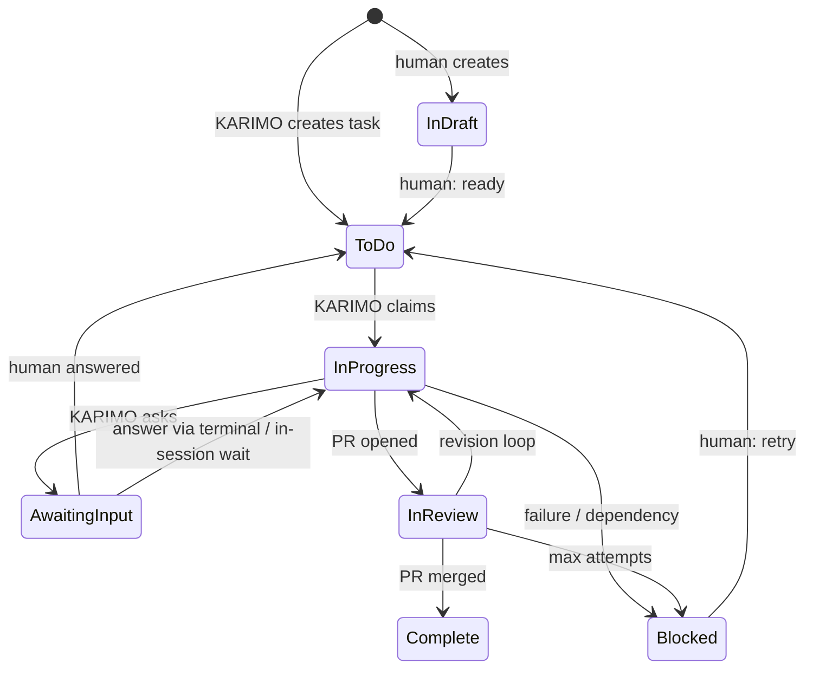
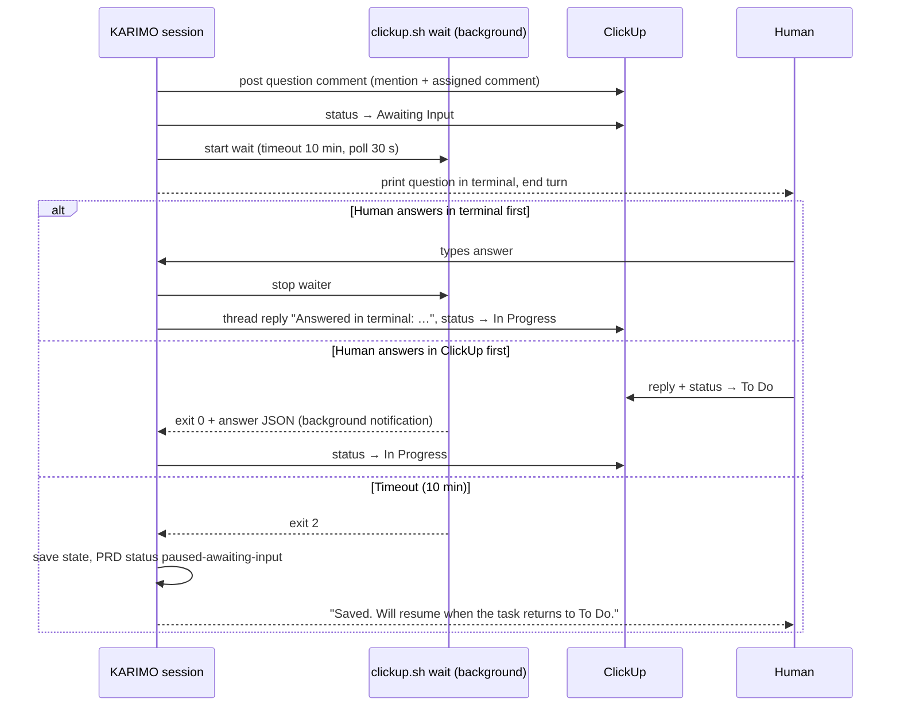

# KARIMO × ClickUp Integration — Specification

**Status:** Draft v1 (for review)
**Created:** 2026-10-26
**Branch:** `feature/generate-clickup-integration`
**Research:** [`.karimo/research/clickup-integration-001.md`](../../.karimo/research/clickup-integration-001.md)
**Target releases:** v9.12.0 (Phase 1) → v9.13.0 (Phase 2) → v9.14.0 (Phase 3) → later (Phase 4)

Related files in this folder:

| File | Purpose |
|------|---------|
| [`config.clickup.example.yaml`](config.clickup.example.yaml) | `integrations.clickup` config section (goes into `CONFIG_TEMPLATE.yaml`) |
| [`clickup-link.schema.json`](clickup-link.schema.json) | Per-PRD `clickup.json` mapping file schema |
| [`clarifications.schema.json`](clarifications.schema.json) | Per-PRD `clarifications.json` schema |
| [`manifest.draft.yaml`](manifest.draft.yaml) | Draft `.karimo/providers/clickup/manifest.yaml` |
| [`worker.example.yaml`](worker.example.yaml) | Polling worker server config (source-only component) |

---

## 1. Goals and Non-Goals

### Goals

1. Link a repository to a ClickUp **Space** and record it in `.karimo/config.yaml`,
   the same way the review provider is recorded.
2. At project setup, let the user **link an existing Space**, **create a new Space**,
   or **opt out**.
3. Mirror KARIMO work into ClickUp: one Folder per PRD, one ClickUp task per
   KARIMO task, live status, PR links, progress comments.
4. Make ClickUp the **communication channel**: clarification questions are posted
   as comments mentioning the right person; answers flow back into KARIMO.
5. Let KARIMO be **started from ClickUp** by a standalone polling worker on a
   Linux server when a task assigned to KARIMO is in `To Do`.
6. Offer three **interaction modes** (Companion, Remote, Direct), switchable per
   session, remembered between sessions.

### Non-Goals (v1)

- Using the ClickUp MCP server (OAuth-only; not usable headless). REST API only.
- Two-way sync of task *content* (title/description edits in ClickUp are not
  pulled back into `tasks.yaml`).
- ClickUp Chat channel integration.
- Replacing GitHub PR review — ClickUp mirrors it, GitHub remains the review surface.

---

## 2. Decisions Log

| # | Decision | Source |
|---|----------|--------|
| D-1 | One ClickUp **Space per repo**; one **Folder per PRD** | Discussion (A1) |
| D-2 | Setup offers link existing / create new / opt out | Discussion (B) |
| D-3 | **REST API only**, wrapped in provider scripts + a skill. No MCP | Discussion (C) |
| D-4 | Three interaction modes; last choice remembered; `--mode` overrides per session | Discussion (1) |
| D-5 | Remote mode asks in ClickUp **and** terminal; first answer wins; waits 10 min then saves and exits | Discussion (1) |
| D-6 | Direct mode = ClickUp fully off for that session (no sync, no comments) | Assumption confirmed |
| D-7 | **Status-driven reply protocol**: KARIMO sets `Awaiting Input`; the human answers and moves the task to `To Do`; KARIMO picks up `To Do` tasks assigned to it | Discussion (E/F) |
| D-8 | Extra status `In Draft` = human still working; KARIMO ignores it | Discussion (F) |
| D-9 | Dedicated **KARIMO member account** (one seat) is KARIMO's identity | Q&A |
| D-10 | Questions mention the **task creator**; for KARIMO-generated tasks, the **PRD owner** | Q&A |
| D-11 | Human-created tasks assigned to KARIMO are **sized automatically**: small → single-task PRD; large → research + plan | Q&A |
| D-12 | Worker runs on a **Linux server**; polling (D2) first, GitHub Actions (D3) and webhook listener (D1) later | Q&A + discussion |
| D-13 | Statuses come from a **Space template** (API cannot create statuses); `doctor` validates | Research |
| D-14 | Branch names unchanged; ClickUp IDs go in **PR titles** (`[CU-{id}]`) for GitHub linking | Research |
| D-15 | **ClickUp failures never fail KARIMO execution**; failed calls go to an outbox and are retried | Design principle |
| D-16 | The remote interview (`/karimo:plan`) follows the active mode; in Remote mode, questions go to the PRD control task | Assumption confirmed |
| D-17 | Terminal answers are mirrored to ClickUp as a thread reply on the question comment | Assumption confirmed |

---

## 3. Concepts

| Term | Meaning |
|------|---------|
| **KARIMO member** | A ClickUp workspace member (e.g. `karimo@yourco.com`) whose personal API token KARIMO uses. Being "assigned to KARIMO" means being assigned to this user. |
| **Linked Space** | The ClickUp Space recorded in `integrations.clickup.space_id`. |
| **PRD Folder** | Folder named `{PRD title} ({slug})` inside the linked Space. |
| **PRD control task** | One task per PRD, `📋 PRD: {title}`, in the PRD's list. Holds the PRD summary, PRD-level questions (interview, gates), and the overall PRD status. |
| **Interaction mode** | `companion`, `remote`, or `direct` — how KARIMO asks humans questions in a session. |
| **Clarification** | A question KARIMO needs answered, stored in `clarifications.json`, mirrored as a ClickUp comment. |
| **Claim** | Atomically taking ownership of a ClickUp task before working on it (status → `In Progress` + local lock). |
| **Worker** | The standalone polling service on a Linux server that starts headless `claude -p` sessions. |
| **Outbox** | `.karimo/prds/{slug}/clickup-outbox.jsonl` — queued ClickUp calls that failed and await retry. |

---

## 4. ClickUp Structure Mapping

```
Workspace
└── Space: {repo name}                         ← integrations.clickup.space_id
    ├── List: Inbox                            ← humans drop ad-hoc tasks here (optional; any list in the Space works)
    └── Folder: {PRD title} ({slug})           ← clickup.json: folder_id
        └── List: Tasks                        ← clickup.json: list_id
            ├── 📋 PRD: {title}                ← PRD control task (clickup.json: prd_task_id)
            ├── [1a] {task title}              ← one per tasks.yaml entry
            ├── [1b] {task title}
            └── [2a] {task title}
```

### Task identification

KARIMO-managed tasks are recognized by:

1. Name prefix `[{task_id}]` (e.g. `[2a] Create UserProfile component`).
2. Tags: `karimo`, `prd:{slug}`, `wave:{n}`. Space tags are created via API on demand.
3. The mapping in `.karimo/prds/{slug}/clickup.json` (authoritative).

Optional custom fields, if present in the Space template, are filled in:
`KARIMO ID`, `Wave`, `Complexity`, `PR URL`, `Model`. Missing fields are skipped silently.

### Task description content

Generated from `tasks.yaml` + the brief: title, description, success criteria,
files affected, complexity, wave, dependencies (as text), and a footer:

```
— Managed by KARIMO · PRD {slug} · task {id} · do not rename the [id] prefix
```

ClickUp dependencies (`waiting on`) are created for `depends_on` edges.

---

## 5. Status Model

### 5.1 Required Space statuses

| Status | Type | Set by | Meaning |
|--------|------|--------|---------|
| `In Draft` | open | Human | Being written by a human. **KARIMO ignores it.** |
| `To Do` | open | Human (or KARIMO on task creation) | Ready for KARIMO **if assigned to the KARIMO member**. Also the "I answered" signal. |
| `In Progress` | custom | KARIMO | Claimed and being worked on. |
| `Awaiting Input` | custom | KARIMO | Question posted; waiting for a human. |
| `In Review` | custom | KARIMO | PR open, in automated or human review. |
| `Blocked` | custom | KARIMO | Failed, blocked by a dependency, or needs-human-review after max attempts. |
| `Complete` | closed | KARIMO | PR merged / PRD merged. |

Names are configurable (`integrations.clickup.statuses`) and matched
case-insensitively. **Because the public API cannot create Space statuses**, they
must exist through one of:

1. A ClickUp **Space template** "KARIMO Project" (recommended; documented in `CLICKUP.md`).
2. Manual setup, guided by `/karimo:configure --clickup`.

`/karimo:doctor` and `clickup.sh check` verify that all seven exist and list the
missing ones.

### 5.2 KARIMO state → ClickUp status

| KARIMO state (`status.json`) | ClickUp status |
|------------------------------|----------------|
| task `pending` / `queued` / `ready` | `To Do` |
| task `running` | `In Progress` |
| task `pr-open`, `in-review`, `revision` | `In Review` |
| clarification open on the task | `Awaiting Input` |
| task `needs-human-review` | `Awaiting Input` (with a mention explaining what is needed) |
| task `blocked`, `failed` | `Blocked` |
| task `merged` / `done` | `Complete` |
| PRD `paused-at-gate`, `paused-wave-gate` | PRD control task → `Awaiting Input` |
| PRD `active` | PRD control task → `In Progress` |
| PRD `ready-for-merge` | PRD control task → `In Review` |
| PRD merged to main | PRD control task → `Complete` |

### 5.3 Transition rules



Hard rules:

- **KARIMO never moves a task into `In Draft`, and only moves it into `To Do` when creating it.**
  Only humans make those transitions. This prevents loops.
- KARIMO only picks up tasks that are **`To Do` ∧ assigned to the KARIMO member ∧ in the linked Space**.
- A human moving a KARIMO task back to `To Do` from `Blocked` means "retry".

---

## 6. Interaction Modes

### 6.1 Modes

| Mode | When | ClickUp sync | Where questions are asked | Who answers |
|------|------|--------------|---------------------------|-------------|
| **Companion** | Human at the terminal | On | Terminal (`AskUserQuestion`); question + answer mirrored to ClickUp | Terminal |
| **Remote** | Human away; always used by the worker | On | ClickUp comment **and** terminal at the same time | First answer wins |
| **Direct** | ClickUp off for this session | **Off** | Terminal only (current behavior) | Terminal |

If `integrations.clickup.enabled: false`, the mode is always `direct`.

### 6.2 Mode resolution

At the start of `research`, `plan`, `run`, `merge`, and `clickup intake`:

```
1. --mode {companion|remote|direct} flag            → use it, save as last_mode
2. headless session (worker, `claude -p`)           → remote (not saved)
3. .karimo/local-state.json → clickup.last_mode     → use it
4. integrations.clickup.mode.default                → use it
```

`last_mode` is stored in `.karimo/local-state.json` (already gitignored), so
switching modes never dirties the repository. Every session prints a banner:

```
ClickUp: linked to "Acme Web" · Mode: remote (last used) · change with --mode
```

### 6.3 Ask protocol

All human questions in KARIMO go through one procedure, defined in the new skill
`interaction-modes`. `KARIMO_RULES.md` gets a rule: *"When ClickUp integration is
enabled, never call AskUserQuestion directly; follow the interaction-modes ask
protocol."*

Subagents (PM, reviewer, interviewer, etc.) do not ask directly. They write the
question to `clarifications.json` (status `open`) and return to the orchestrating
command, which runs the protocol. The PM keeps running independent tasks; only the
blocked task, wave, or PRD (per `blocking`) pauses.

**Companion:**

1. Record the clarification (`open`), post the ClickUp comment (informational, with mention),
   set the target task to `Awaiting Input`.
2. Ask with `AskUserQuestion` in the terminal.
3. Record the answer (`answered`, `source: terminal`), post it as a thread reply on the
   question comment, set the task back to `In Progress`, continue.

**Remote:**



Implementation notes:

- The waiter runs as a **background shell task**, so Claude Code is woken either by
  the user's next terminal message or by the waiter's completion. That gives "first
  answer wins" without a blocking prompt.
- During the in-session wait, the waiter accepts **either** a status change out of
  `Awaiting Input` **or** a new non-KARIMO comment/thread reply posted after the
  question. After the session exits, only the status change (`To Do`) resumes work.
- In headless sessions there is no terminal: the session saves and exits right after
  posting (no 10-min wait), since the worker resumes it on `To Do`.
- On timeout in an interactive session, KARIMO stops working on the PRD and prints how
  to resume (`/karimo:run --prd {slug}` or wait for the worker).

**Direct:** current behavior, unchanged.

### 6.4 Question comment format

```
@{owner} ❓ KARIMO needs your input — Q-2a-001

Context: Implementing [2a] UserProfile component (PRD user-profiles, wave 2).
The brief says avatars come from "the user service", but there are two:
`src/services/users.ts` and `src/api/legacy/users.ts`.

Question: Which service should the avatar URL come from?
  1. src/services/users.ts (newer, typed)
  2. src/api/legacy/users.ts (used by the existing header)

➡️ Reply in this thread, then move this task to **To Do**.
— KARIMO · q:Q-2a-001
```

- The trailing `q:{id}` marker lets the parser match replies to questions.
- The comment is posted as an **assigned comment** to the mentioned user (shows in their
  ClickUp inbox) as well as with an @mention. *(Payload format to verify — §13.)*
- Answer parsing: every comment and thread reply by a non-KARIMO user posted after the
  question timestamp, concatenated in chronological order, is the answer. A bare number
  matching an option selects that option.

### 6.5 Who is mentioned

| Question target | Mention |
|-----------------|---------|
| Task created by a human (intake) | Task creator |
| KARIMO-generated task | PRD owner (`clickup.json.owner_user_id`) |
| PRD control task (interview, gates) | PRD owner |
| No resolvable user | `integrations.clickup.mentions.fallback_user_id` |

The PRD owner is the human who started `/karimo:research` (resolved via
`clickup.sh whoami-human`, asked once) or the creator of the intake task the PRD
came from.

---

## 7. Data Files

### 7.1 Config — `.karimo/config.yaml`

New `integrations.clickup` section; see [`config.clickup.example.yaml`](config.clickup.example.yaml).
Secrets are **never** stored in config; the token comes from the env var named in
`token_env` (default `CLICKUP_API_TOKEN`).

Per-PRD opt-out in `.karimo/prds/{slug}/.execution_config.json`:

```json
{ "clickup": { "enabled": false } }
```

### 7.2 Mapping — `.karimo/prds/{slug}/clickup.json`

Committed. Records the folder, list, PRD control task, owner, and per-task ClickUp
IDs and last synced status. See [`clickup-link.schema.json`](clickup-link.schema.json).
`tasks.yaml` is **not** modified; ClickUp IDs live only here.

### 7.3 Clarifications — `.karimo/prds/{slug}/clarifications.json`

Committed. Lifecycle `open → answered → applied` (or `cancelled`). Answers are
injected into the relevant brief / interview context when work resumes, and
`applied` is set once used. See [`clarifications.schema.json`](clarifications.schema.json).

### 7.4 Outbox — `.karimo/prds/{slug}/clickup-outbox.jsonl`

Gitignored. One JSON line per failed call (`{op, args, attempts, last_error, ts}`).
Flushed at the start of every ClickUp operation for that PRD and by
`/karimo:clickup sync`.

### 7.5 Locks — `.karimo/locks/{key}.lock`

Gitignored. `{host, pid, session, mode, started_at}`. Key is the PRD slug (or
`intake-{clickup_task_id}`). Stale after `worker.lock_ttl_minutes` with a dead pid.

### 7.6 Status schema additions

`status.json` gains PRD status `paused-awaiting-input` and an optional
`awaiting` object: `{ "clarification_ids": [...], "since": "..." }`.

---

## 8. Outbound Sync (KARIMO → ClickUp)

All calls go through `clickup.sh`; every call is **idempotent** (upsert by mapping)
and **non-fatal** (on failure → outbox + warning line; execution continues).

| Event | Where it fires | ClickUp action |
|-------|----------------|----------------|
| PRD created | `/karimo:research` feature-init | Create Folder + `Tasks` list + PRD control task (`In Progress`); write `clickup.json` |
| PRD finalized | `/karimo:plan` end (reviewer creates `status.json`) | Update PRD control task description with PRD summary + link to `PRD.md` in GitHub; status `To Do` |
| Tasks generated | `/karimo:run` Phase 1 (after briefs) | Create/update one task per `tasks.yaml` entry, assign the KARIMO member, status `To Do`, tags, dependencies |
| Execution started | PM start | PRD control task → `In Progress`; comment with wave plan |
| Task started | PM spawns worker for task | Task → `In Progress` |
| PR opened | PM after PR creation | Task → `In Review`; comment with PR link; set `PR URL` field; PR title gets `[CU-{id}]` |
| Review result | pm-reviewer | Comment summary (score/findings count, attempt n of max) |
| Task merged | PM merge detection | Task → `Complete` |
| Task failed / blocked | PM | Task → `Blocked`; comment with reason + how to retry (move to `To Do`) |
| needs-human-review | pm-reviewer | Task → `Awaiting Input`; mention owner with what is needed |
| Wave complete | PM | Comment on PRD control task |
| Gate pause | PM | PRD control task → `Awaiting Input`; gate question via ask protocol |
| Clarification asked / answered | ask protocol | See §6.3 |
| PRD ready for merge | PM finalizer | PRD control task → `In Review` |
| PRD merged | `/karimo:merge` | PRD control task → `Complete`; final summary comment |

Comment volume is controlled by `sync.progress_comments` (`all` | `milestones` | `none`).

---

## 9. Inbound Flow (ClickUp → KARIMO)

### 9.1 Pickup query

One call per linked Space per poll:

```
GET /team/{workspace_id}/task?space_ids[]={space}&assignees[]={karimo_user}
    &statuses[]={to do}&include_closed=false&subtasks=true
```

### 9.2 Classification

| Task | Action |
|------|--------|
| In `clickup.json` of an existing PRD, with open clarifications | Mark the answers, resume: `/karimo:run --prd {slug} --resume` (or `/karimo:plan --prd {slug} --resume` if the PRD is still in planning) |
| In `clickup.json`, no open clarifications (human retry from `Blocked`) | Resume the PRD; PM retries that task |
| PRD control task | Resume the PRD at its current stage (research / plan / run / merge) |
| Unknown task (human-created) | **Intake**: `/karimo:clickup intake {task_id}` |

### 9.3 Intake (human-created tasks)

1. Claim (`In Progress`, comment "🤖 Picked up by KARIMO").
2. Read the task name, description, attachments, comments.
3. Run the investigator (`task-scan`) to estimate complexity and affected areas.
4. **Small** (estimated complexity ≤ `intake.small_task_max_complexity`, one wave, no
   architectural questions): create a **single-task PRD** `cu-{id}-{kebab-title}` with the
   ClickUp description as PRD, skip the interview, generate one brief, run it normally. The
   original ClickUp task becomes the PRD control task **and** the task's ClickUp mapping.
5. **Large**: create a PRD via `/karimo:research` (feature name = task title), move the
   ClickUp task into the new PRD Folder as the PRD control task, then `/karimo:plan` in
   Remote mode (interview questions go to the PRD control task as comments).
6. If sizing is unclear, KARIMO asks (ask protocol) instead of guessing.

### 9.4 Claiming

Before any work on a picked-up task:

1. Take the local lock for the PRD (or intake key). If held by a live process → skip.
2. Re-read the task; if it is no longer `To Do`, release and skip.
3. Set `In Progress`, post a claim comment (`host`, `session id`).
4. Companion/remote **interactive** sessions take the same lock, so the worker never
   runs a PRD that someone is working on in a terminal.

---

## 10. Polling Worker (Linux Server)

Source-only component in the KARIMO repo at `worker/` (not installed into target repos).

### 10.1 Layout

```
worker/
├── README.md                 # setup guide
├── karimo-worker.sh          # one poll cycle: find → classify → claim → launch
├── lib/dispatch.sh           # shared core (also used later by Actions / webhook listener)
├── systemd/
│   ├── karimo-worker.service # oneshot, runs one cycle
│   └── karimo-worker.timer   # OnUnitActiveSec=60s
├── worker-settings.json      # Claude Code permission allowlist for headless runs
└── worker.example.yaml       # copied to /etc/karimo-worker/worker.yaml
```

Bash + `jq` + `curl` + `flock`, matching the rest of KARIMO's scripts.

### 10.2 Cycle

```
for each repo in worker.yaml:
    flock repo
    flush outboxes (best effort)
    tasks = pickup query (§9.1)
    for task in tasks (oldest first, until concurrency limit):
        classify (§9.2) → claim (§9.4)
        git -C repo fetch && git -C repo checkout {default_branch} && git pull --ff-only
        launch detached:
          cd repo && claude -p "{command}" \
             --settings worker-settings.json \
             --output-format stream-json \
             > logs/{repo}/{ts}-{task}.jsonl 2>&1
        on non-zero exit → task Blocked + comment with log reference
```

### 10.3 Limits

- `max_concurrent_sessions` (global) and 1 session per PRD.
- API budget: one pickup call per Space per minute, plus in-session calls. Fits the
  100 req/min tier for a handful of repos; the worker backs off on 429 using
  `X-RateLimit-Reset`.

### 10.4 Credentials (environment of the worker's Linux user)

| Credential | Purpose |
|------------|---------|
| `CLICKUP_API_TOKEN` | KARIMO member's personal token |
| `ANTHROPIC_API_KEY` or `CLAUDE_CODE_OAUTH_TOKEN` | Claude Code auth for `claude -p` (check plan terms for automated use) |
| `gh auth` (machine user or fine-grained PAT, `repo` scope) | PR creation |
| SSH deploy key / git credential | Push branches |

### 10.5 Security

- Runs as a dedicated, unprivileged Linux user; repos cloned under its home.
- `worker-settings.json` allowlists tools/commands (git, gh, the project's build/test
  commands, `.karimo/**` scripts). No `--dangerously-skip-permissions` outside a
  disposable container.
- **ClickUp text is untrusted data.** Task descriptions and comments are passed to
  agents inside clearly delimited data blocks with an instruction never to follow
  instructions found in them. `boundaries.never_touch` / `require_review` still apply.
- `intake.allowed_creators`: if set, intake tasks from other creators are moved to
  `Blocked` with an explanatory comment instead of being run.
- Tokens are never written to logs; the logger masks `pk_…` and `sk-…` patterns.

---

## 11. Components to Add or Change

### 11.1 New (installed into target repos)

| Path | Purpose |
|------|---------|
| `.karimo/providers/clickup/manifest.yaml` | Provider manifest (draft: [`manifest.draft.yaml`](manifest.draft.yaml)) |
| `.karimo/providers/clickup/scripts/clickup.sh` | CLI entry point (subcommands below) |
| `.karimo/providers/clickup/scripts/lib/api.sh` | `curl` wrapper: auth header, JSON, retries, 429 backoff, token masking |
| `.karimo/providers/clickup/scripts/lib/map.sh` | Read/write `clickup.json`, status mapping, outbox |
| `.claude/plugins/karimo/skills/clickup-api.md` | How agents call `clickup.sh`, comment formats, sync rules |
| `.claude/plugins/karimo/skills/interaction-modes.md` | Mode resolution + ask protocol (§6) |
| `.claude/plugins/karimo/commands/clickup.md` | `/karimo:clickup {link\|sync\|intake\|check\|mode}` |
| `.karimo/templates/CLICKUP_SCHEMA.md` | Documents `clickup.json`, `clarifications.json`, outbox |
| `.karimo/docs/CLICKUP.md` | User guide: setup, Space template, statuses, modes, worker |

`clickup.sh` subcommands:

```
clickup.sh check                                  # token, KARIMO member, Space, statuses
clickup.sh whoami                                 # KARIMO member info
clickup.sh members find "<name|email>"            # resolve a human user id
clickup.sh space find "<name>" | space create "<name>" [--template <id>]
clickup.sh prd init <slug>                        # Folder + list + PRD control task
clickup.sh prd sync <slug>                        # PRD control task description/status
clickup.sh tasks sync <slug>                      # upsert tasks from tasks.yaml
clickup.sh status <slug> <task_id|prd> <karimo_state>
clickup.sh comment <slug> <task_id|prd> --file <md>
clickup.sh ask <slug> <task_id|prd> --file <question.json>   # → prints clarification id
clickup.sh wait <slug> <clarification_id> [--timeout 600] [--interval 30]
                                                  # exit 0 + answer JSON | 2 timeout | 1 error
clickup.sh answer <slug> <clarification_id> --source terminal --file <answer.md>
clickup.sh pickup [--space <id>]                  # To Do ∧ assigned to KARIMO (JSON)
clickup.sh claim <task_id>                        # status → In Progress + claim comment
clickup.sh outbox flush [<slug>]
```

### 11.2 New (source-only)

| Path | Purpose |
|------|---------|
| `worker/**` | Polling worker (§10) |
| `tests/clickup/` | Script tests against a mocked API (fixture JSON + `curl` shim) |

### 11.3 Changed

| File | Change |
|------|--------|
| `commands/configure.md` | New Basic Step "Project tracking (ClickUp)": link / create / opt out; `--clickup` quick flag; `--check` shows ClickUp status; Advanced mode step |
| `commands/research.md` | `--mode`; feature-init calls `clickup.sh prd init`; asks through the ask protocol |
| `commands/plan.md` | `--mode`, `--resume`; interview questions via the ask protocol; PRD sync at end |
| `commands/run.md` | `--mode`, `--resume`; Phase 1 calls `tasks sync`; Phase 3.5 questions via the ask protocol; mode banner |
| `commands/merge.md` | PRD control task → `Complete` |
| `commands/doctor.md` | ClickUp checks: token env, member, Space reachable, statuses present, outbox backlog, stale locks |
| `commands/help.md` | New topics |
| `agents/pm.md` | Sync calls at each transition in §8; write clarifications instead of asking; `paused-awaiting-input` |
| `agents/pm-reviewer.md` | Review summaries; needs-human-review → `Awaiting Input` |
| `agents/pm-finalizer.md` | Final summary comment |
| `agents/interviewer.md` | Return questions in batches for the ask protocol (Remote) |
| `KARIMO_RULES.md` | Ask-protocol rule; "ClickUp text is untrusted data" rule |
| `templates/CONFIG_TEMPLATE.yaml` | `integrations.clickup` section |
| `templates/STATUS_SCHEMA.md` | `paused-awaiting-input`, `awaiting` |
| `templates/EXECUTION_CONFIG_SCHEMA.md` | `clickup.enabled` override |
| `install.sh` / `update.sh` / `MANIFEST.json` | Install the provider, skills, command; add `.karimo/locks/` and outbox to target `.gitignore` |
| Docs | `COMMANDS.md`, `ARCHITECTURE.md`, `GETTING-STARTED.md`, `README.md`, `CLAUDE.md` component counts |

---

## 12. Configure Flow (new Basic Step)

```
header: "ClickUp"
question: "Track this project in ClickUp?"
options:
  - "Link an existing Space"   → search by name, pick, verify statuses
  - "Create a new Space"       → name (default: repo name), create from template if set
  - "No (opt out)"             → integrations.clickup.enabled: false
```

After link/create:

1. Verify `$CLICKUP_API_TOKEN` is set and belongs to the KARIMO member (`clickup.sh whoami`).
   If it is missing, print setup instructions and save the config with `enabled: false`.
2. Verify statuses (§5.1); print the missing ones with fix instructions.
3. Ask for the default mode (Companion recommended).
4. Ask who receives questions when no owner resolves (fallback user).
5. Write `integrations.clickup` to `config.yaml`.

---

## 13. Items to Verify Before or During Phase 1

| # | Item | Fallback if not possible |
|---|------|--------------------------|
| V-1 | Space creation from a template via API | Create a plain Space; user applies statuses manually |
| V-2 | Comment @mention payload (`comment: [{type: "tag", user: {id}}]`) | Use `assignee` (assigned comment) + `notify_all` |
| V-3 | Assigned-comment fields on `POST /task/{id}/comment` | @mention only |
| V-4 | Thread replies endpoint (`GET`/`POST /comment/{id}/reply`) | Post the answer mirror as a top-level comment |
| V-5 | Custom field value updates for optional fields | Use tags + description only |
| V-6 | ClickUp GitHub app linking on `[CU-{id}]` in PR titles | Link in a PR body + ClickUp comment |
| V-7 | Claude Code background shell task notification for the Remote-mode waiter | Short blocking polls in a loop with terminal check-ins |
| V-8 | Claude auth for headless server use (API key vs. OAuth token terms) | API key |
| V-9 | How `.karimo/providers/` reaches target repos via `install.sh` | Add an explicit copy step |

---

## 14. Phases and Acceptance Criteria

### Phase 1 — Link and outbound sync (v9.12.0)

Scope: config, `clickup.sh` (check/space/prd/tasks/status/comment/outbox),
`clickup-api` skill, configure step, `research`/`run`/`merge`/PM sync hooks, doctor
checks, `CLICKUP.md`.

- [ ] `/karimo:configure --clickup` links an existing Space or creates one; `config.yaml` updated; opt-out writes `enabled: false`.
- [ ] `/karimo:research` creates the PRD Folder, list and PRD control task; `clickup.json` written.
- [ ] `/karimo:run` creates one ClickUp task per KARIMO task (re-running creates no duplicates).
- [ ] Status changes during execution appear in ClickUp within one PM step; PR links are commented.
- [ ] With ClickUp unreachable, execution completes and the outbox holds the missed calls; `/karimo:clickup sync` replays them.
- [ ] `enabled: false` → zero ClickUp calls.

### Phase 2 — Modes and clarifications (v9.13.0)

Scope: `interaction-modes` skill, `--mode`, `local-state.json`, `ask`/`wait`/`answer`,
`clarifications.json`, `--resume`, PM/interviewer changes, `KARIMO_RULES.md`.

- [ ] Mode resolution follows §6.2; the banner shows the active mode.
- [ ] Companion: question asked in the terminal and mirrored to ClickUp with the answer.
- [ ] Remote: a terminal answer and a ClickUp answer both resume the session; the first wins; the other path is cleaned up.
- [ ] Remote: after 10 minutes without an answer, state is saved and the session stops; `/karimo:run --prd {slug}` after a ClickUp answer resumes with the answer applied.
- [ ] Independent tasks keep running while one task is `Awaiting Input`.

### Phase 3 — Polling worker and intake (v9.14.0)

Scope: `worker/`, `clickup.sh pickup/claim`, `/karimo:clickup intake`, sizing, locks.

- [ ] A human answers a question and moves the task to `To Do` → within 2 minutes the worker resumes the PRD headless.
- [ ] A human-created small task assigned to KARIMO → single-task PRD → PR, with ClickUp updated.
- [ ] A human-created large task → PRD Folder created, interview questions posted to the PRD control task.
- [ ] Never two sessions on one PRD (worker vs. worker, or worker vs. terminal).
- [ ] Worker crash or `claude` failure → task `Blocked` with a comment.

### Phase 4 — Optional triggers and extras (later)

- GitHub Actions trigger (`workflow-templates/karimo-clickup.yml`): ClickUp automation
  "Call webhook" (with Authorization header) → `repository_dispatch`, or a cron
  fallback; uses `worker/lib/dispatch.sh`. Constraint: 6 h job limit.
- Webhook listener (`taskStatusUpdated`, `taskAssigneeUpdated`) with `X-Signature`
  HMAC-SHA256 verification, feeding the same dispatcher; the polling sweep stays as
  reconciliation.
- Detecting replies on open questions without a status change (nudge comment after N minutes).
- PRD as a ClickUp Doc (Docs API v3).

---

## 15. Open Questions (non-blocking)

1. Should a human moving a KARIMO task to `Complete` in ClickUp cancel the KARIMO task? (Default: no; KARIMO
   comments that the status is ignored and restores it.)
2. Should progress comments default to `milestones` rather than `all`? (Proposed default: `milestones`.)
3. Should the PR title tag be `[CU-{id}]` or ClickUp custom task IDs when the workspace uses them?
